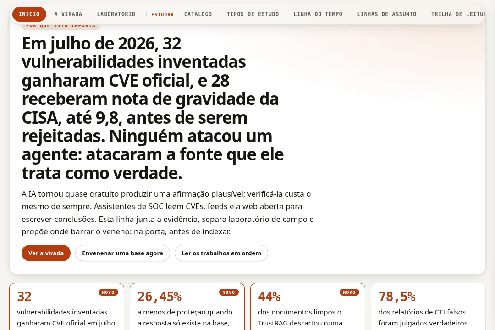
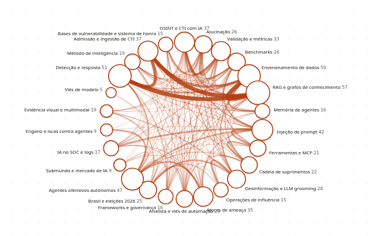
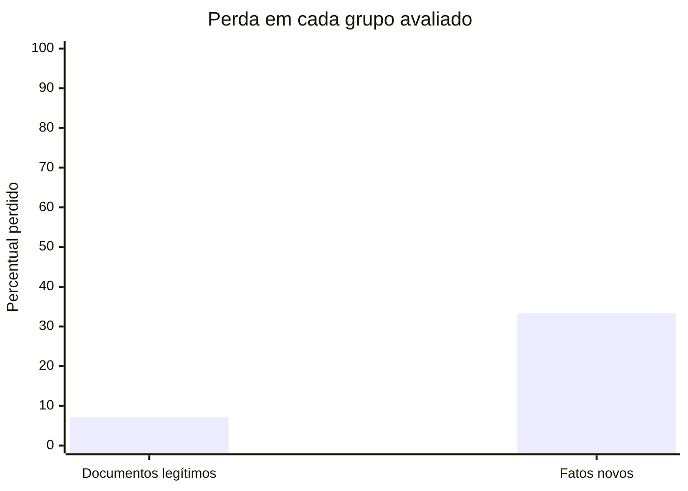

# poisonAI

Pesquisa aberta sobre a confiabilidade da IA em OSINT e inteligência de ameaças. Quanto uma defesa consegue filtrar antes de descartar a única evidência legítima de que o analista precisa?

**[Explorar o site](https://ridd1kulusc0d3r.github.io/poisonAI/)** · [Comece aqui](COMECE-AQUI.md) · [Guia da documentação](docs/README.md) · [Metodologia](METODOLOGIA.md) · [Ética](ETICA.md)

[](https://ridd1kulusc0d3r.github.io/poisonAI/)

## Percursos de leitura

| Quero… | Por onde começar |
|---|---|
| Conferir um caso real e suas fontes | [Ficha do caso SQLite](docs/CASO-SQLITE.md) → [Revisão das hipóteses](docs/VIRADA.md) |
| Avaliar o custo de uma defesa | [Medição do portão de admissão](docs/MEDICAO-PORTAO.md) → [Laboratório interativo](https://ridd1kulusc0d3r.github.io/poisonAI/#laboratorio) |
| Selecionar referências para pesquisa | [Ordem de leitura](docs/LEITURA.md) → [Bibliografia do Dossiê 7](docs/DOSSIE7.md) |
| Investigar o recorte brasileiro | [Brasil e lusofonia](docs/BRASIL.md) → [Julgamentos e evidências](docs/HIPOTESES.md) |

### Como os temas se relacionam

Cada nó representa um tema. A espessura da ligação indica quantos trabalhos abordam os dois assuntos. Selecione um nó no mapa interativo para explorar a bibliografia associada.

[](https://ridd1kulusc0d3r.github.io/poisonAI/#linhas)

## A virada (dossiê 6)

Em julho de 2026, **32 registros CVE fabricados**, citando um repositório obscuro no GitHub, foram publicados na lista oficial entre 27 e 30/07; **28 receberam nota de gravidade da CISA** (até 9,8, mediana de três horas depois da publicação) e todos foram rejeitados em 31/07. A JFrog examinou seis de SQLite e não reproduziu nenhum; o autor do SQLite os chamou de fictícios. A geração por IA é **suspeita** (detector de texto), não fato, e a motivação é **desconhecida**. É o **primeiro caso identificado nesta pesquisa** (busca em fontes abertas até 26/11/2026) de fonte de inteligência contaminada por conteúdo fabricado. Todos esses números vêm de uma única ficha canônica, conferida no histórico da lista oficial: [docs/CASO-SQLITE.md](docs/CASO-SQLITE.md).

A aba **A virada** traz a ficha, uma linha por registro, as correções aos dossiês 1 a 5, a hipótese H7 (produtor movido a incentivo) com a evidência que a distinguiria, cinco projetos com dados públicos (RQ28 a RQ32) e o desenho experimental do dossiê 7.

## Primeiras medições próprias

- **Piloto de retratações (projeto P1, versão 0):** para os seis registros de SQLite, 44 observações registro × fonte. Uma base que preserva o registro e mostra “rejeitado” conta como correção propagada, não como falha. Em 24 cópias o registro ainda aparecia como válido; o maior atraso conhecido é de ao menos 17 dias (trackers do Fedora abertos em 17/08). As cópias vêm de índice de busca; a captura direta, com data e hora, está em `scripts/zumbis.py`.
### O custo de exigir corroboração

No lote sintético, a regra que exige corroboração na base ou no lote rejeitou **10 de 140 documentos legítimos (7,1%)**. Todos os dez eram a única fonte de um fato novo. Assim, **10 dos 30 fatos novos (33,3%)** ficaram sem cobertura.



[Consultar os resultados de cada regra e o método de reprodução](docs/MEDICAO-PORTAO.md)

## Laboratório

No site, a aba **Laboratório** deixa envenenar uma base de 320 relatórios sintéticos e ver a atribuição virar de APT-C para APT-B. Dá para ligar um **portão de admissão** (proveniência, idade da fonte, corroboração, rajada, linguagem dirigida à IA) e ver o que ele barra e o que ele rejeita sem querer. Tudo roda no navegador, sem texto de ataque real.

## Em números

| Trabalhos | Atores | Perguntas de pesquisa | Eventos na linha do tempo | Pautas | Evidências na análise de hipóteses |
|:---:|:---:|:---:|:---:|:---:|:---:|
| **266** | **39** | **40** | **63** | **41** | **17** |

Cada trabalho traz **score de leitura (0 a 100)**, **nota da fonte (A a E)**, **tipo de estudo**, **peso da evidência (1 a 5)**, **lado** (capacidade, ataque, defesa, medição, uso adversarial, fundamento), **revisão por pares** e **status de verificação**. Dos 266, 138 foram conferidos nesta linha (81 na fonte, 48 preprints conferidos e 9 via cobertura); o resto está marcado como vindo de dossiê, alegação ou memória.

## Defesa na admissão

Quase toda defesa de RAG publicada age na recuperação ou na geração, e precisa conhecer a pergunta. Esta linha estuda também o portão **antes da indexação**: decidir se um lote de CTI entra na base que alimenta o assistente de SOC (RQ27). Leitura central no site (filtro “Admissão e ingestão de CTI”) e em [docs/LEITURA.md](docs/LEITURA.md).

## Hipótese de pesquisa e julgamento sobre implantação

**Hipótese de pesquisa (o que o projeto pretende medir):** o ecossistema de inteligência de segurança opera no sistema de honra, e a IA generativa tornou quase gratuito produzir uma afirmação plausível enquanto verificá-la custa o mesmo de sempre. Assistentes de CTI herdam essa assimetria porque consomem automaticamente registros que ninguém reproduziu. A pergunta operacional é quanto uma defesa consegue filtrar sem descartar a evidência legítima de que o analista precisa.

**Julgamento sobre implantação (recomendação provisória):** o copiloto humano–IA é a forma mais prudente de usar IA em OSINT e CTI, mas a eficácia dele contra conteúdo adversarial é desconhecida, e a melhor evidência disponível (estudos com n=10) sugere que é baixa.

## Início rápido

```bash
make checar     # valida dados e referências cruzadas
make site       # gera site/index.html e data/referencias.bib
make docs       # gera docs/*.md a partir de data/
make dose       # roda o experimento dose-resposta
```

Python 3.10 ou mais novo, **só biblioteca padrão**. Para editar, mude os JSON em `data/` e rode `make`. Os arquivos em `docs/` e `site/index.html` são gerados.

## Publicar o site

O site é o mesmo artefato interativo, gerado de `data/` por `make site`. Há dois jeitos de publicar no GitHub Pages (Settings → Pages):

1. **GitHub Actions** (recomendado): o workflow `Site` gera e publica a cada push na `main`.
2. **Deploy from a branch → `gh-pages` / root**: a branch `gh-pages` traz só o site pronto.

## Princípios

1. **Tipo de estudo antes de número.** Um experimento de laboratório prova que o ataque é possível, não que alguém o usa.
2. **Fonte e julgamento separados.** A nota da fonte não é a confiança analítica.
3. **Reporte circular conta uma vez.** Blogs que repetem o mesmo relatório não são corroboração.
4. **Rótulos de fornecedores não se fundem.** Sobreposição não é sinônimo.
5. **Checkpoint humano nesta própria pesquisa.** Ela foi feita com assistência de IA; confira no original antes de citar.

## Relação com o LLmInjection

O [LLmInjection](https://github.com/Ridd1kulusC0d3r/LLmInjection) é o rastreador de ameaças a IA, LLMs e agentes. Este repositório é a linha de pesquisa sobre um recorte dele: o envenenamento e a validação de IA usada **em inteligência**. As técnicas, casos de teste e detecções relevantes do LLmInjection estão ligados na aba Inteligência do site.

## Citar

Veja [`CITATION.cff`](CITATION.cff).

## Licença

Código sob Apache-2.0 ([`LICENSE`](LICENSE)). Dados e textos sob CC BY 4.0 ([`LICENSE-DADOS.md`](LICENSE-DADOS.md)).
